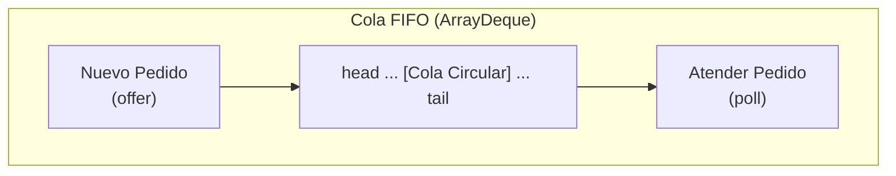
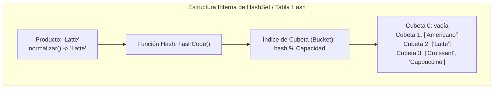
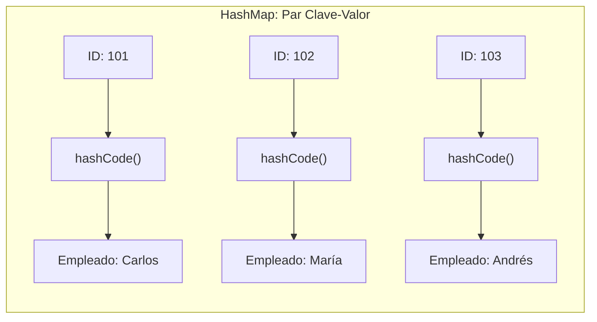
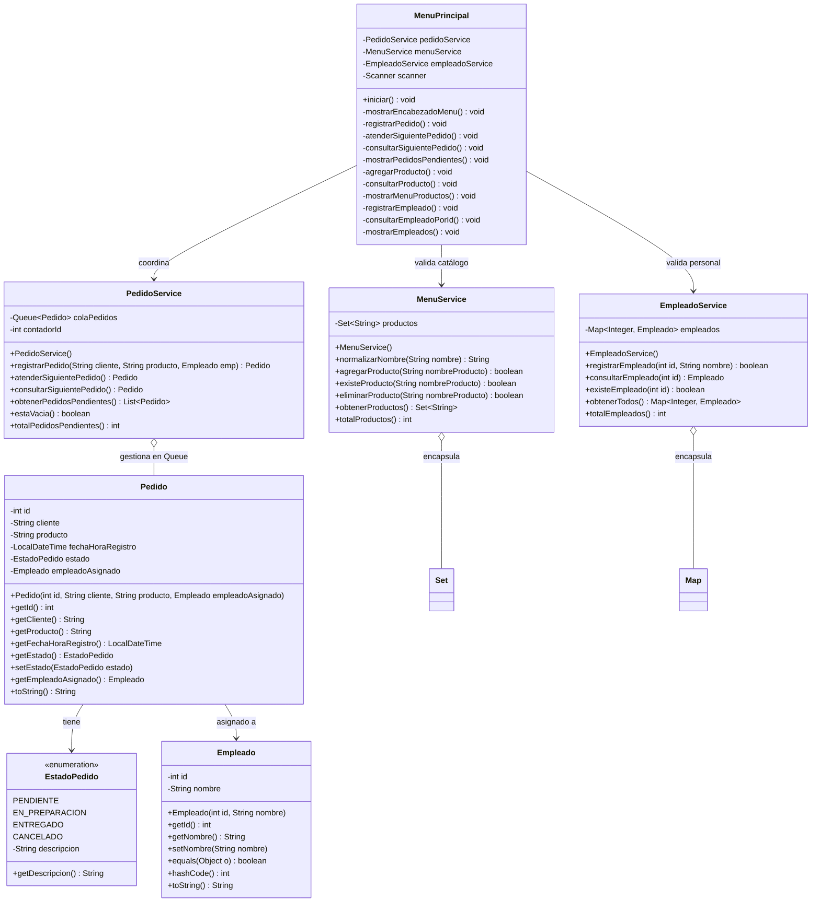
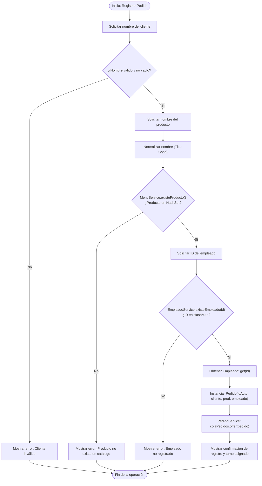

# JUSTIFICACIÓN TÉCNICA DE ESTRUCTURAS DE DATOS

## Proyecto: CoffeeShopEA2 – Sistema de Gestión de Cafetería
**Asignatura:** Estructuras de Datos  
**Programa:** Tecnología en Desarrollo de Software  
**Institución:** Institución Universitaria Digital de Antioquia (IU Digital)  

---

## 1. CUADRO COMPARATIVO GENERAL DE ESTRUCTURAS

| Módulo / Requisito | Tipo de Dato Abstracto (TDA) | Interfaz JCF | Implementación Concreta | Complejidad Temporal (Operaciones Clave) |
|---|---|---|---|---|
| **Gestión de Pedidos** | Cola FIFO (*First-In, First-Out*) | `java.util.Queue<Pedido>` | `java.util.ArrayDeque<Pedido>` | Inserción (`offer`): **$O(1)$ amortizado**<br>Extracción (`poll`): **$O(1)$ amortizado**<br>Consulta (`peek`): **$O(1)$** |
| **Catálogo del Menú** | Conjunto (*Set*) | `java.util.Set<String>` | `java.util.HashSet<String>` | Búsqueda (`contains`): **$O(1)$ promedio**<br>Inserción (`add`): **$O(1)$ promedio**<br>Eliminación (`remove`): **$O(1)$ promedio** |
| **Registro de Personal** | Diccionario / Mapa Clave-Valor | `java.util.Map<Integer, Empleado>` | `java.util.HashMap<Integer, Empleado>` | Búsqueda (`get`): **$O(1)$ promedio**<br>Verificación (`containsKey`): **$O(1)$ promedio**<br>Inserción (`put`): **$O(1)$ promedio** |

---

## 2. JUSTIFICACIÓN DETALLADA POR ESTRUCTURA Y ANÁLISIS DE ALTERNATIVAS

### 2.1 Módulo 1: Gestión de Pedidos (`ArrayDeque` vs. `LinkedList` vs. `ArrayList`)

Para modelar la atención al cliente de la cafetería, el requerimiento central exige el principio de **orden de llegada estricto (FIFO)**.



#### ¿Por qué `ArrayDeque`?
1. **Cola circular en arreglo contiguo:** `ArrayDeque` implementa un buffer circular sobre un arreglo dinámico sin necesidad de desplazar elementos al extraer. Mantiene punteros lógicos `head` y `tail`.
2. **Eficiencia de memoria y caché (Localidad Espacial):** A diferencia de `LinkedList`, que debe asignar un nuevo objeto contenedor `Node` con punteros `next` y `prev` para cada pedido en el *heap*, `ArrayDeque` almacena referencias en memoria contigua, minimizando la fragmentación y optimizando los aciertos en la memoria caché L1/L2 del procesador.
3. **No permite nulos:** Evita inserciones ambiguas en la cola, garantizando la integridad del flujo de trabajo.

#### Descarte de alternativas:
- **`ArrayList`:** Aunque ofrece inserción al final en $O(1)$ amortizado, extraer el primer pedido (`remove(0)`) obliga a desplazar los $n-1$ elementos restantes una posición a la izquierda en memoria mediante `System.arraycopy()`. Esta operación es **$O(n)$**, degradando drásticamente el rendimiento en colas concurridas.
- **`LinkedList`:** Cumple con la interfaz `Queue` y ofrece $O(1)$ para `offer` y `poll`, pero incurre en una sobrecarga de memoria significativa (aproximadamente 24 bytes adicionales por nodo de 64 bits) y genera mayor presión sobre el Recolector de Basura (*Garbage Collector*) debido a la dispersión de nodos en memoria.

---

### 2.2 Módulo 2: Catálogo del Menú (`HashSet` vs. `TreeSet` vs. `ArrayList`)

El menú requiere garantizar que no existan productos duplicados (independiente de diferencias entre mayúsculas y minúsculas) y permitir consultas instantáneas sobre la disponibilidad de un producto.



#### ¿Por qué `HashSet`?
1. **Unicidad matemática:** Cumple con la definición de conjunto del TDA *Set*, impidiendo registros duplicados mediante el contrato `hashCode()` y `equals()`.
2. **Complejidad constante:** La verificación de existencia (`contains()`) y la inserción (`add()`) operan en tiempo constante **$O(1)$ promedio**, calculando directamente la cubeta correspondiente sin recorrer los demás elementos.
3. **Normalización previa:** El servicio implementa `normalizarNombre()` para transformar cualquier variante ("latte", "LATTE", " Latte ") a un formato uniforme antes de someterlo al cálculo del hash, garantizando unicidad léxica total.

#### Descarte de alternativas:
- **`TreeSet`:** Almacena los elementos en un árbol rojinegro balanceado (*Red-Black Tree*). Si bien mantiene los elementos ordenados lexicográficamente, sus operaciones de inserción, búsqueda y eliminación tienen complejidad **$O(\log n)$**. Dado que el requerimiento principal es la búsqueda rápida y no el orden estricto continuo, $O(\log n)$ es subóptimo frente a $O(1)$.
- **`ArrayList`:** Carece de mecanismos de unicidad. Para evitar duplicados en una lista, cada inserción requeriría invocar `contains()`, el cual realiza una búsqueda secuencial exhaustiva de complejidad **$O(n)$**.

---

### 2.3 Módulo 3: Registro de Empleados (`HashMap` vs. `TreeMap` vs. `ArrayList`)

Cada empleado cuenta con un número de identificación único (ID) que debe asociarse con sus datos laborales para validaciones inmediatas al momento de facturar o atender pedidos.



#### ¿Por qué `HashMap`?
1. **Indexación directa por clave primaria:** Mapea directamente el `ID` (entero positivo) a la instancia de `Empleado`.
2. **Acceso ultrarrápido:** Las operaciones `get(id)` y `containsKey(id)` se resuelven en **$O(1)$ promedio**.
3. **Desacoplamiento semántico:** Permite consultar la existencia del empleado sin necesidad de iterar sobre una colección de objetos.

#### Descarte de alternativas:
- **`TreeMap`:** Ordena las claves mediante un árbol binario balanceado, incurriendo en un costo temporal de **$O(\log n)$** para cada acceso o validación de clave. En un sistema de punto de venta donde el personal se valida en cada transacción, el acceso de tiempo constante de `HashMap` es la opción superior.
- **`ArrayList<Empleado>`:** Para buscar un empleado por ID en una lista desordenada, debe aplicarse una búsqueda lineal de complejidad **$O(n)$**. Incluso si se mantuviera ordenada para aplicar búsqueda binaria ($O(\log n)$), las inserciones requerirían reorganizar el arreglo ($O(n)$).

---

## 3. DIFERENCIACIÓN DE COMPLEJIDADES COMPUTACIONALES: PROMEDIO, AMORTIZADO Y PEOR CASO

Comprender la diferencia formal entre estos tres conceptos es indispensable para la defensa académica del proyecto:

```
+-----------------------------------------------------------------------------------------+
|                                    NIVELES DE COMPLEJIDAD                               |
+------------------------------+------------------------------+---------------------------+
|      CASO PROMEDIO           |        CASO AMORTIZADO       |         PEOR CASO         |
+------------------------------+------------------------------+---------------------------+
| Representa el costo esperado | Promedio del costo de una    | El escenario más adverso  |
| sobre distribuciones típicas | secuencia de operaciones a   | posible para una entrada  |
| de datos de entrada.         | lo largo del tiempo.         | particular.               |
|                              |                              |                           |
| Ejemplo:                     | Ejemplo:                     | Ejemplo:                  |
| HashSet y HashMap operan en  | ArrayDeque redimensiona el   | Si todos los elementos de |
| O(1) si la función hash      | arreglo cuando se llena      | un HashSet colisionan en  |
| distribuye uniformemente los | (costo puntual O(n)), pero   | un solo bucket, degenera  |
| elementos en las cubetas.    | prorrateado entre n copias,  | en árbol (O(log n) Java8+) |
|                              | cada inserción cuesta O(1).  | o lista enlazada (O(n)).  |
+------------------------------+------------------------------+---------------------------+
```

### Detalle de cada concepto:

1. **Complejidad Caso Promedio ($O(1)$ en `HashSet` y `HashMap`):**
   - Asume una función de dispersión uniforme (*uniform hashing assumption*). Los elementos se reparten equitativamente entre los buckets disponibles. La longitud de cada lista o árbol de colisión es aproximadamente $1$, por lo que la búsqueda toma tiempo constante.

2. **Complejidad Amortizada ($O(1)$ en `ArrayDeque`):**
   - Un `ArrayDeque` inicia con un tamaño fijo de arreglo (típicamente 16 posiciones). Cuando la cola se llena, la estructura duplica la capacidad mediante una copia masiva que toma tiempo $O(n)$.
   - Sin embargo, para que ocurra esa costosa operación de duplicación, tuvieron que realizarse previamente $n$ operaciones de costo constante $O(1)$. Al dividir el costo total entre la secuencia completa de operaciones, el costo por operación individual se garantiza en **$O(1)$ amortizado**.

3. **Peor Caso ($O(n)$ o $O(\log n)$):**
   - Ocurre cuando se presentan condiciones anómalas deliberadas o accidentales:
     - En `HashSet` / `HashMap`: Si múltiples claves devuelven exactamente el mismo valor hash (*hash collisions* masivas). Desde Java 8, si una cubeta supera 8 elementos colisionados, Java convierte la lista enlazada interna en un árbol balanceado rojinegro, reduciendo el peor caso de $O(n)$ a **$O(\log n)$**.
     - En `ArrayDeque`: La duplicación puntual de memoria en un instante específico toma $O(n)$.

---

## 4. VENTAJAS DE PROGRAMAR DIRIGIDO A INTERFACES (*Coding to Interfaces*)

En el código fuente de `CoffeeShopEA2`, los atributos y retornos se tipifican con las interfaces del Java Collections Framework:

```java
// Correcto: Programar orientado a la interfaz (Abstracción y Polimorfismo)
private final Queue<Pedido> colaPedidos = new ArrayDeque<>();
private final Set<String> productos = new HashSet<>();
private final Map<Integer, Empleado> empleados = new HashMap<>();
```

### Ventajas Técnicas y de Ingeniería de Software:
1. **Principio de Inversión de Dependencias (SOLID):** Los módulos de alto nivel (como la interfaz de usuario `MenuPrincipal`) dependen de abstracciones (`Queue`, `Set`, `Map`) y no de detalles de bajo nivel (`ArrayDeque`, `HashSet`, `HashMap`).
2. **Mantenibilidad y Sustituibilidad (Principio de Liskov):** Si en el futuro el negocio requiere una cola persistente en disco o concurrente para múltiples cajas (`ConcurrentLinkedQueue`), o un mapa sincronizado, solo se modifica la instanciación concreta sin alterar ningún método que consuma la estructura.
3. **Desacoplamiento Estructural:** Evita que el cliente invoque métodos propietarios de una clase concreta que no forman parte del contrato formal del TDA, preservando la portabilidad y limpieza del diseño.

---

## 5. DIAGRAMAS DEL SISTEMA

### 5.1 Diagrama UML de Clases



---

### 5.2 Diagrama de Flujo: Registro de un Pedido



